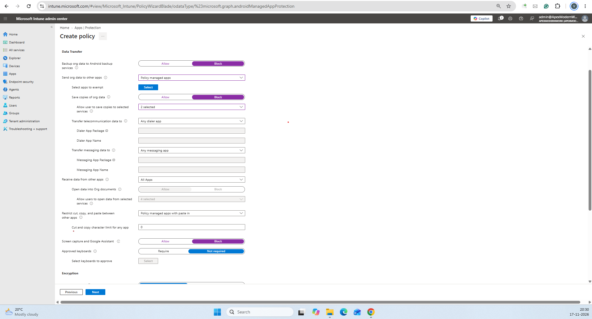
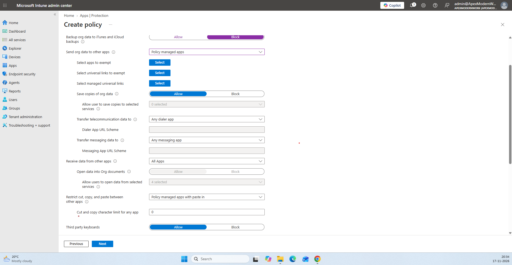
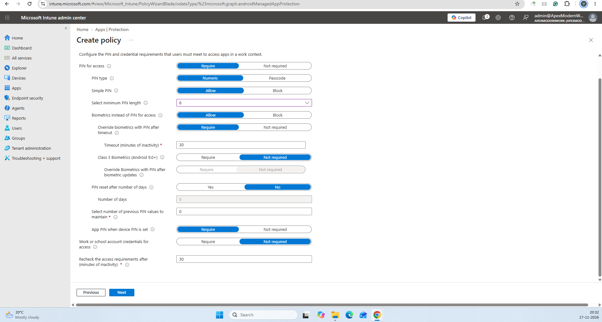
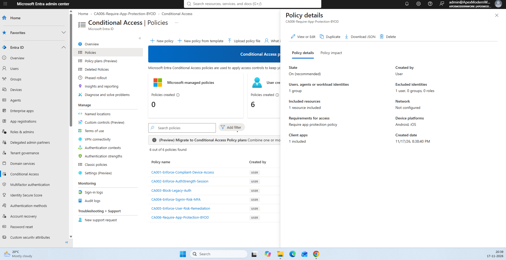
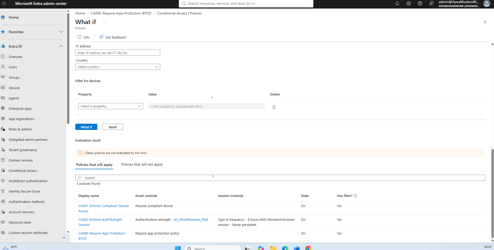
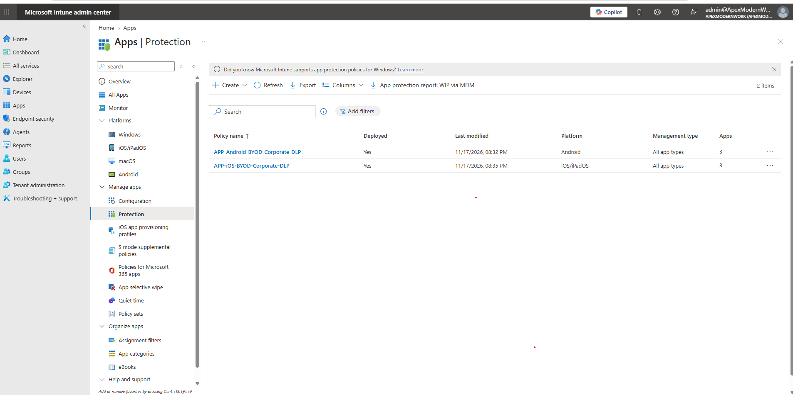

cd "C:\Users\Administrator\Desktop\Enterprise-Intune-MAM-AppProtection-Lab"

# Normalize .jpg, .jpeg, or .png.png to single .png
Get-ChildItem -Recurse -File | Where-Object { $PSItem.Name -match '\.(jpg|jpeg|png\.png)$' } | Rename-Item -NewName { $PSItem.Name -replace '\.(jpg|jpeg|png\.png)$', '.png' }

# Write clean README.md
@'
# Microsoft Intune MAM: BYOD App Protection & Conditional Access Lab

Enterprise Mobile Application Management (MAM) and BYOD Data Loss Prevention (DLP) lab built on **Microsoft Intune**, **Microsoft Entra ID Conditional Access**, and **Windows 11 Pro** (`TESTUSER-1`) within the `ApexModernWork.onmicrosoft.com` tenant.

## Architecture Overview

This lab protects corporate Microsoft 365 data on unmanaged personal mobile devices without requiring full MDM device enrollment:

1. **Android BYOD App Protection Policy (`APP-Android-BYOD-Corporate-DLP`):** Enforced application-level DLP controls across **Microsoft Outlook**, **Microsoft Teams**, and **Microsoft OneDrive** for `SG-M365-Pilot-Devices-Users`, blocking Android cloud backups, unauthorized app data transfers, local Save As (restricting to OneDrive for Business/SharePoint), cross-app copy/paste, and screen capture, while enforcing data encryption and a 6-digit access PIN.
2. **iOS/iPadOS BYOD App Protection Policy (`APP-iOS-BYOD-Corporate-DLP`):** Mirrored equivalent container-level DLP boundaries, managed-app data isolation, and 6-digit PIN enforcement across iOS/iPadOS corporate applications.
3. **Conditional Access App Protection Enforcement (`CA006-Require-App-Protection-BYOD`):** Deployed Conditional Access targeting **Android** and **iOS** mobile client apps accessing **Office 365** (`SG-M365-Pilot-Devices-Users`, excluding break-glass administration), requiring an active Intune App Protection Policy prior to token issuance.
4. **Layered Policy Evaluation (`What If` Telemetry):** Validated multi-policy Conditional Access evaluation for `pilotuser1@ApexModernWork.onmicrosoft.com` on Android mobile clients, confirming `CA006-Require-App-Protection-BYOD` enforces alongside `CA001-Enforce-Compliant-Device-Access` and `CA002-Enforce-AuthStrength-Session`.

---

## Lab Evidence & Artifacts

### 01. Intune App Protection Policies (Android & iOS BYOD DLP)

* **#01 Android Data Protection Controls (`APP-Android-BYOD-Corporate-DLP`):** Blocked Android backup services, restricted data sharing to policy-managed apps, blocked local Save As, enforced `0`-character cut/copy limits to unmanaged apps, blocked screen capture/Assistant, and mandated data encryption.

* **#02 iOS/iPadOS Data Protection Controls (`APP-iOS-BYOD-Corporate-DLP`):** Enforced parallel iOS application-layer DLP boundaries across Outlook, Teams, and OneDrive without requiring device enrollment.

* **#03 Access Requirements & PIN Enforcement:** Configured mandatory 6-digit numeric app PIN with 30-minute inactivity recheck and scoped deployment to `SG-M365-Pilot-Devices-Users`.

---

### 02. Conditional Access Enforcement & MAM Telemetry

* **#04 Conditional Access Policy (`CA006-Require-App-Protection-BYOD`):** Scoped to Android and iOS mobile client apps accessing Office 365, enforcing **Grant access: Require app protection policy**.

* **#05 Conditional Access `What If` Simulation (`pilotuser1`):** Verified simultaneous evaluation of `CA006-Require-App-Protection-BYOD`, `CA001-Enforce-Compliant-Device-Access`, and `CA002-Enforce-AuthStrength-Session` for mobile Exchange Online access.

* **#06 Intune App Protection Deployment Summary:** Confirmed active deployment (`Deployed: Yes`) across 3 targeted apps for both Android and iOS BYOD App Protection Policies in Microsoft Intune.

'@ | Set-Content -Path .\README.md -Encoding UTF8

# Print exact relative paths on disk
Get-ChildItem -Recurse -File | Resolve-Path -Relative
